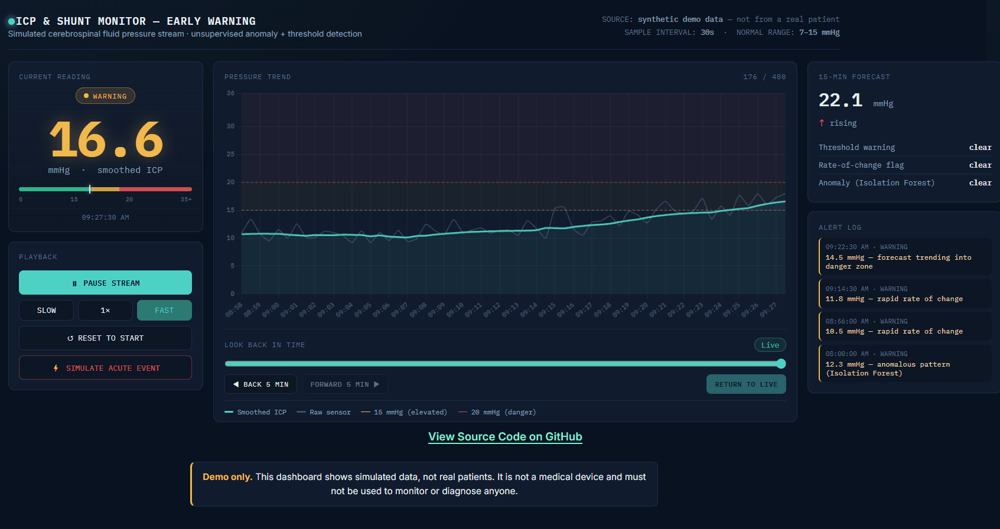

# 📈 Brain Pressure Monitoring Engine

> A vibe-coded Python-driven biomedical signal processing and anomaly detection engine paired with a web dashboard to monitor time-series Intracranial Pressure (ICP) data, predict hydrocephalus shunt failures, and trigger early warning alerts. All data is synthetic and generated with Python.

## 🔬 View the Website
**Explore the live interactive monitor:** [https://happyjasondev.github.io/brain-pressure-monitoring-engine/](https://happyjasondev.github.io/brain-pressure-monitoring-engine/)

## 🖱️ How it works:

* **Synthetic Simulation`:**	Creates 4 hours of ICP data (480 readings, one every 30s). It has a normal baseline of about 11 mmHg, sensor noise, brief movement artifacts, a slow shunt-blockage climb, and a sharp acute spike.
* **Two-Stage Signal Processing:**	Smooths the signal, then applies four checks: a sustained-threshold rule (>20 mmHg for 5+ min), a rate-of-change rule, an Isolation Forest anomaly detector, and a 15-minute linear-trend forecast. These combine into a normal, warning, or high-risk label for each reading.
* **Visualization of Data:**	Plays the data back like a bedside monitor. It shows a color-coded big number (0-15 mmHg = normal = green, 15-20 mmHg = elevated = yellow, >20 mmHg = danger = red), a trend chart with shaded risk bands, the forecast, which rule fired, and an alert log. A Simulate acute event button injects a live pressure spike.
* **Viewing History:** A slider is implemented for viewing past data, so users can identify which event triggered an abnormal brain pressure at which time.

## 🛠️ Key Features & Technical Architecture

* **Synthetic Physiological Data Generation (`generate_data.py`):** Programmed a mathematical telemetry simulator generating 4 hours ($480$ samples at $30\text{-second}$ intervals) of continuous ICP dynamics, incorporating baseline physiological drift ($\approx 11\text{ mmHg}$), Gaussian sensor noise, patient movement artifacts, slow occlusion gradients, and acute pathological surges.
* **Hybrid Signal Analytics & Anomaly Detection (`analyze.py`):**
  * **Digital Filtering & Smoothing:** Applied rolling window transformations (`pandas`, `NumPy`) to mitigate transient motion artifacts while preserving true pressure wave dynamics.
  * **Rule-Based Physiological Thresholding:** Implemented sustained-elevation logic ($\text{ICP} > 20\text{ mmHg}$ for $\ge 5\text{ consecutive minutes}$) alongside derivative rate-of-change ($dP/dt$) triggers.
  * **Unsupervised Machine Learning:** Integrated an `IsolationForest` ensemble model (`scikit-learn`) to detect multidimensional structural anomalies directly from raw waveform morphology without relying on ground-truth event labels.
  * **Short-Horizon Predictive Forecasting:** Engineered a rolling linear regression window to forecast $15\text{-minute}$ future pressure trends and slope trajectories as a lightweight, dependency-free substitute for recurrent neural networks (e.g., LSTMs).
* **Interactive Web Telemetry Dashboard (`dashboard.html`):** Developed a real-time web interface mimicking a clinical bedside monitor, complete with color-coded risk stratification ("Normal", "Warning", "High Risk"), dynamic trend charts with safety boundaries, alert logs, and an interactive event-injection trigger.

## 💻 Tech Stack & Dependencies

| Category | Technology / Library |
| :--- | :--- |
| **Language** | Python 3.x, HTML5/CSS3/JavaScript |
| **Data Processing & Analytics** | `Pandas`, `NumPy`, `JSON` |
| **Machine Learning** | `scikit-learn` (`sklearn.ensemble.IsolationForest`) |
| **Frontend and Data Visualization** | Chart.js / HTML5 Web APIs, `Matplotlib` |

## ⚠️ Disclaimer

This software is developed solely for educational and portfolio purposes.
All data streams, waveform inputs, and pressure values are synthetic and do not represent real human patient data.
The analytical pipeline, anomaly flags, and predictive trend forecasts do not constitute medical software, clinical diagnosis, or treatment recommendations.
Real-world intracranial pressure interpretation and hydrocephalus management must always be conducted by qualified medical professionals using regulatory-approved medical hardware and software.
